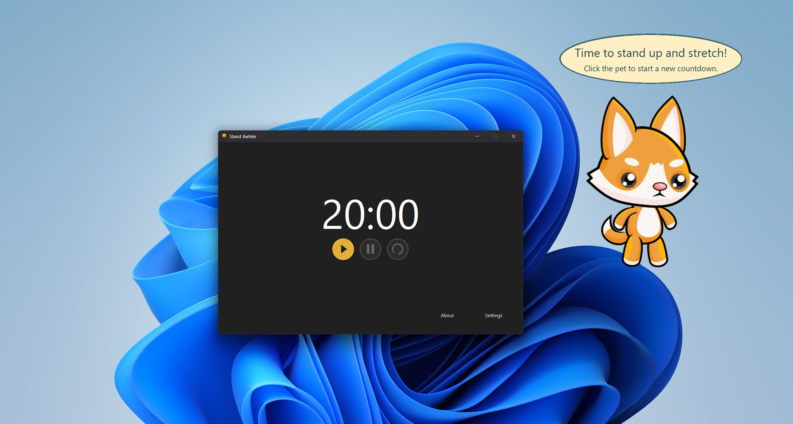
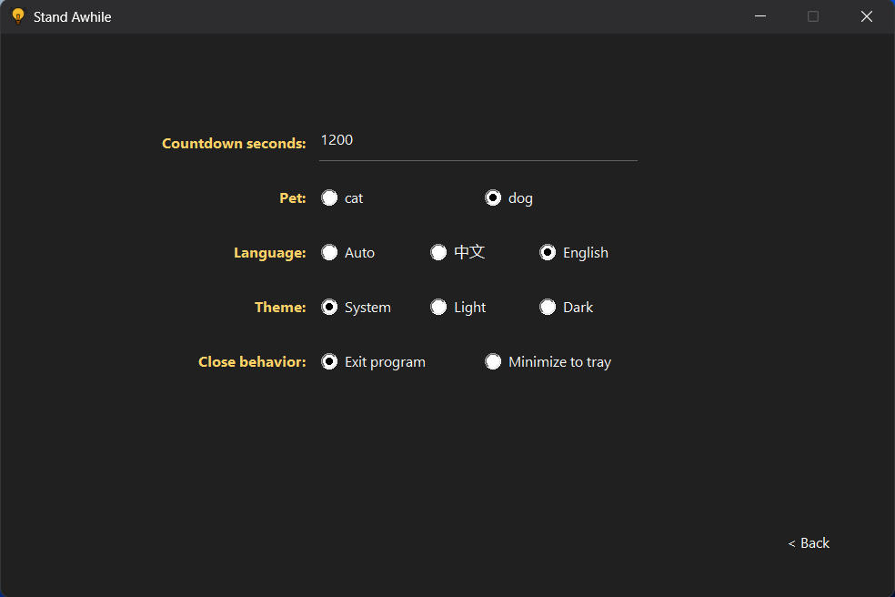

# Stand Awhile (站一站)

English | [简体中文](README.zh.md)

**Stand Awhile** is a lightweight Windows desktop reminder. Every 20 minutes by default, a friendly desktop pet appears to remind you to stand up, stretch, and move, without taking focus away from your work.

Built in Rust using only native Win32 APIs. Extremely lightweight: a single EXE file that uses 1–5 MB of memory at runtime, depending on the system environment.

> Stand awhile, breathe, and stretch.

## ✨ Features

- **Lightweight and portable**: Download and run a single EXE file.
- **Desktop pet reminders**: A cat or dog with a speech bubble reminds you to take a movement break.
- **Adjustable intervals**: Use the default 20 minutes or choose an interval that suits you.
- **Background timer**: Keep the countdown running with the main window hidden, and access controls from the system tray.
- **Personalized appearance**: Chinese and English interfaces, with system, light, and dark themes.
- **Launch at startup**: Optionally start a background countdown when you sign in to Windows.

## 📸 Screenshots

## 🚀 Download and Get Started

Requires **Windows 10 or later**.

1. Visit the [Releases page](https://github.com/yin-hai-bo/stand-awhile/releases) and download the executable. Extract it first if it comes in an archive.
2. Run `stand-awhile.exe`. No additional runtime installation is needed.
3. Click **Play** to start the countdown. By default, the main window hides automatically while the timer continues in the background.
4. When time is up, the pet appears with a reminder to move. After taking a break, click the pet to hide it and start the next countdown.

Both the cat and dog are included. No additional images or resource files are needed.

## 🐾 Everyday Use

| What you want to do | How to do it |
| --- | --- |
| Start or resume the timer | Click Play in the main window, or use the tray or pet context menu |
| Pause reminders | Click Pause to pause the countdown and hide the pet |
| Start a fresh countdown | Click Reset, then Play to start the full configured interval |
| Acknowledge a reminder and start the next countdown | Click the pet |
| Move the pet | Drag it; the app remembers its position |
| Bring back the main window | Right-click the app icon in the system tray and choose Show main window |
| Change settings | Click Settings in the main window, or use the tray or pet context menu |
| Quit the app | Choose Exit from the tray or pet context menu |

**Closing the window keeps the app running in the background by default.** The countdown and pet reminders continue. To quit completely, choose Exit from a context menu or change the close behavior in Settings.

Opening the app again brings back the existing main window without restarting the countdown.

## ⚙️ Make It Yours

| Setting | What it does |
| --- | --- |
| Reminder interval | Defaults to 20 minutes. Enter a whole number of at least 1 minute, then click Back to apply |
| Pet character | Choose a cat or dog |
| Language | Follow the Windows UI language automatically, or choose Chinese or English |
| Theme | Follow the system theme, or choose light or dark |
| Closing the main window | Hide to the tray and keep running, or exit the app |
| Auto-hide main window when starting the timer | On by default. Turn it off to prevent starting or resuming the timer from automatically hiding the window |
| Launch at startup | Off by default. Enable it to start a background countdown when you sign in to Windows |

Changing the reminder interval replaces the remaining countdown. Other settings keep the current countdown intact. Character, language, theme, and similar options are saved and applied immediately.

Click **Reset to defaults** to restore the default settings, including the 20-minute interval. Your launch-at-startup preference is preserved.

## ❓ Frequently Asked Questions

- **Q: Why did the window disappear when I started the timer?**

  - A: Auto-hide is enabled by default, and the timer is still running in the background. Use the app icon in the system tray to bring back the main window, or turn off auto-hide in Settings.

- **Q: Is it normal to see no window when the app launches at startup?**

  - A: Yes. Startup launches the countdown in the background, and the pet appears when time is up. You can open the main window from the tray.

- **Q: Do I need administrator privileges to enable launch at startup?**

  - A: No. If you move the executable, run it once from its new location to update the startup path.

- **Q: How do I dismiss the pet reminder?**

  - Click the pet to hide it and start the next countdown. To stop reminders temporarily, open the main window and click Pause.
