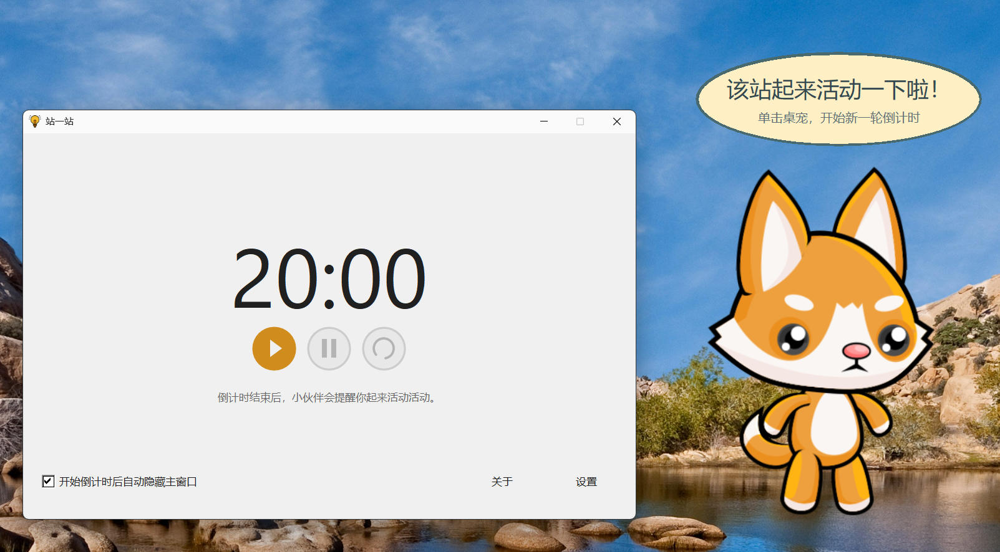
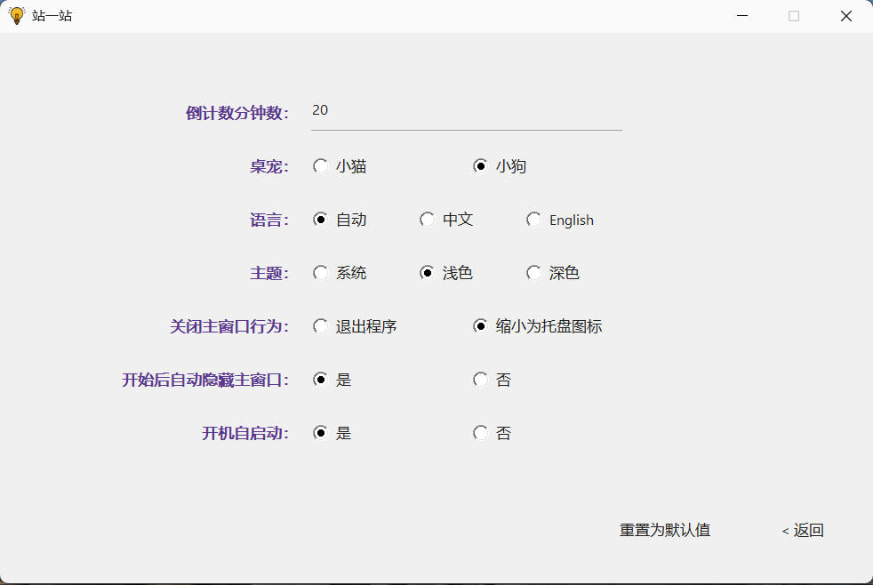

# Stand Awhile（站一站）

[English](README.md) | 简体中文

**《站一站》** 是一款轻量级 Windows 桌面提醒工具。默认每隔 20 分钟，可爱的桌宠就会出现，提醒你站起来、伸展身体、活动一下，不抢占工作焦点。

使用 Rust 调用纯 Win32 API 实现，资源占用极少：仅需单一 EXE 文件，运行时内存占用为 1～5 MB（视系统环境而定）。

> 站一站，深呼吸，伸个懒腰。

## ✨ 功能特点

- **轻巧便携**：下载即可运行，只需一个 EXE 文件。
- **桌宠提醒**：猫咪或小狗配合对话气泡，提醒你适时起身活动。
- **自由设置间隔**：默认 20 分钟，可按自己的习惯调整。
- **后台计时**：隐藏主窗口后继续计时，随时通过系统托盘操作。
- **个性化外观**：支持中英文，以及跟随系统、浅色和深色主题。
- **开机启动**：可在登录 Windows 后自动在后台开始计时。

## 📸 界面截图

## 🚀 下载与开始使用

适用于 **Windows 10 及以上版本**。

1. 打开[发布页面](https://github.com/yin-hai-bo/stand-awhile/releases)，下载可执行文件；如果是压缩包，请先解压。
2. 运行 `stand-awhile.exe`，无需安装额外运行环境。
3. 点击**开始**，启动倒计时。默认会自动隐藏主窗口，在后台继续计时。
4. 时间到后，桌宠会出现并提醒你活动。起身休息后，点击桌宠将其隐藏，并开始下一轮倒计时。

猫咪和小狗均已内置，无需另外下载图片或资源文件。

## 🐾 日常使用

| 想做什么 | 如何操作 |
| --- | --- |
| 开始或继续计时 | 点击主窗口的“开始”，或使用托盘、桌宠右键菜单 |
| 暂停提醒 | 点击“暂停”，倒计时暂停，桌宠隐藏 |
| 重新计时 | 点击“重置”，再点击“开始”，按设定的完整间隔重新计时 |
| 确认提醒并开始下一轮 | 点击桌宠 |
| 移动桌宠 | 拖动桌宠，程序会记住位置 |
| 找回主窗口 | 右键点击系统托盘中的程序图标，选择“显示主窗口” |
| 修改设置 | 点击主窗口的“设置”，或从托盘、桌宠右键菜单进入 |
| 完全退出 | 在托盘或桌宠右键菜单中选择“退出” |

**关闭窗口后，程序默认仍在后台运行。** 倒计时和桌宠提醒会继续；如需完全退出，请使用菜单中的“退出”，或在设置中更改关闭行为。

再次运行程序会显示已有的主窗口，不会重新开始倒计时。

## ⚙️ 按自己的习惯设置

| 设置 | 说明 |
| --- | --- |
| 提醒间隔 | 默认 20 分钟，可输入至少 1 分钟的整数；点击“返回”后应用 |
| 桌宠角色 | 选择猫咪或小狗 |
| 语言 | 自动跟随 Windows 界面语言，或手动选择中文、英文 |
| 主题 | 跟随系统，或选择浅色、深色 |
| 关闭主窗口时 | 隐藏到托盘并继续运行，或退出程序 |
| 开始计时时自动隐藏主窗口 | 默认开启；关闭后，开始或继续计时不会自动隐藏主窗口 |
| 开机启动 | 默认关闭；开启后，登录 Windows 即在后台开始倒计时，无需手动打开程序 |

更改提醒间隔会重新设置剩余计时；其他设置不会打断当前倒计时。角色、语言、主题等选项更改后会立即保存并生效。

点击**恢复默认设置**可恢复 20 分钟等默认设置，开机启动选项会保留。

## ❓ 常见问题

- **Q: 开始计时后，窗口为什么不见了？**

  - A: 默认开启了自动隐藏，程序仍在后台计时。可通过系统托盘中的程序图标找回主窗口，也可关闭自动隐藏选项。

- **Q: 开机启动后，没有看到窗口，是否正常？**

  - A: 正常。开机启动会直接在后台开始计时，时间到后桌宠才会出现。你可以通过托盘查看主窗口。

- **Q: 需要管理员权限才能设置开机启动吗？**

  - A: 不需要。如果移动了程序文件，请从新位置手动运行一次，以更新开机启动路径。

- **Q: 桌宠提醒出现后如何关闭？**

  -A: 点击桌宠即可隐藏它并开始下一轮倒计时。如果想暂时停止提醒，请打开主窗口并点击“暂停”。
